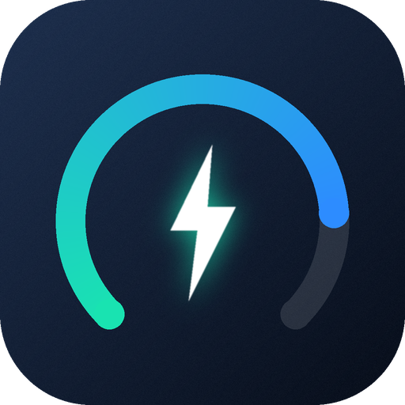

# DJI Power for Home Assistant

A custom [Home Assistant](https://www.home-assistant.io/) integration that reads and controls a
**DJI Power** portable power station — over the **DJI cloud** or directly over **Bluetooth**, and
you can switch between the two at any time.

> **Unofficial.** This project is not affiliated with, endorsed by, or supported by DJI. "DJI" is a
> trademark of SZ DJI Technology Co., Ltd. The integration relies on a reverse-engineered, undocumented
> API and Bluetooth protocol that DJI can change at any moment. Use it at your own risk — switching
> the AC output off cuts the power to whatever is plugged into it.

## Features

- **Live readings**, about once per second: battery level, input and output power, battery
  temperature, remaining time, charging state.
- **Control** the built-in lamp (on/off, brightness, SOS effect) and every output port
  (AC, USB-C, USB-A, DC) as native `light` and `switch` entities.
- **Two connection modes**, switchable in the integration options:
  - **Cloud** — via the DJI cloud (MQTT for readings, REST for control). Works from anywhere.
  - **Bluetooth** — directly to the power station through Home Assistant's Bluetooth stack
    (local adapter or Bluetooth proxy). No cloud needed after the initial sign-in.
- **Sign in with a single token.** The serial number and the Bluetooth pairing key are fetched
  from your DJI account automatically; you only choose your device.
- **Automatic discovery** of the power station over Bluetooth.
- **Re-authentication** flow when the token expires, and editable token / pairing key in the options.
- Device info shows model, serial number and firmware version. English and Dutch translations.

## Requirements

- Home Assistant **2024.11** or newer (developed and tested on 2026.10).
- [HACS](https://hacs.xyz/) (or a manual install).
- A DJI account that has your power station bound, and its **member token** (see
  [Getting your member token](#getting-your-member-token)).
- For Bluetooth mode: a Bluetooth adapter on the Home Assistant host (or a Bluetooth proxy) that is
  within range of the power station.

## Installation

### HACS (custom repository)

1. In HACS open the **⋮** menu → **Custom repositories**.
2. Add `https://github.com/meinmotion/dji-power` with type **Integration**.
3. Search for **DJI Power**, open it and choose **Download**.
4. **Restart Home Assistant.**

### Manual

Copy `custom_components/dji_power/` into the `custom_components/` folder of your Home Assistant
configuration and restart.

## Setup

Go to **Settings → Devices & services → Add integration → DJI Power**.

1. Choose **Sign in with member token** and paste your token. The integration lists the power
   stations bound to your account; pick yours.
2. Choose the connection mode: **Cloud** or **Bluetooth**. For Bluetooth, pick the discovered power
   station (it advertises as `Power1000Mini-<last 6 characters of the serial number>`).
3. Optional: choose **Bluetooth only** at the start to enter the serial number and the 32-character
   pairing key by hand and skip the token entirely.

If a power station is in range, Home Assistant may also offer it automatically as a discovered device.

## Getting your member token

The integration needs the `x-member-token` of your DJI Home session (a long string starting with
`US_`). **There is currently no built-in login**: DJI's account login needs request-signing identifiers
that have not been captured, so a username/password flow is not possible yet. Obtaining the token
means extracting it from the DJI Home app session of *your own* account; this repository does not ship
that tooling.

Treat the token like a password. It is stored in the Home Assistant config entry, and it typically stays
valid for days to weeks, after which Home Assistant asks you to sign in again.

Bluetooth does not remove the need for a token: the pairing key that the Bluetooth handshake needs is
delivered through the cloud (`pair_info.pair_key` of your device list). You need the token once to fetch
it, after which a Bluetooth entry works without it. If you already know your pairing key you can skip the
token altogether (*Bluetooth only*).

## Connection modes

| | **Cloud** | **Bluetooth** |
|---|---|---|
| Needs internet | Yes | No (after sign-in) |
| Needs a valid token | Always | Only to fetch the pairing key |
| Range | Anywhere | Within range of an adapter or proxy |
| Update rate | ~1 s | ~1 s |
| Phone app at the same time | Yes | **No** — the power station accepts one Bluetooth connection at a time, so the DJI app cannot connect while Home Assistant holds it |

Things worth knowing:

- Commands sent over Bluetooth reach the device immediately, but the **cloud's copy of the state
  lags by roughly 20–55 seconds**. Don't judge a Bluetooth switch by looking at the DJI cloud.
- In Bluetooth mode the entities become *unavailable* while the connection is down, and the
  integration reconnects automatically with a growing back-off.
- Switch modes in **Settings → Devices & services → DJI Power → Configure**.

## Entities

All entities belong to one device ("DJI Power", with model, serial number and firmware version).

| Platform | Entity (English name) | Notes |
|---|---|---|
| `sensor` | Battery | % |
| `sensor` | Output power / Input power | W |
| `sensor` | Battery temperature | °C |
| `sensor` | Remaining time | minutes |
| `sensor` | Light brightness | % |
| `binary_sensor` | Charging | |
| `light` | Light | the built-in lamp: brightness and an *SOS* effect |
| `switch` | One per output port | AC, USB-C 1/2, USB-A 1/2 and DC (SDC); discovered from the device, so other models get their own port layout. Port names are currently Dutch (e.g. *AC-uitgang*) |

The firmware version shown is the main firmware. The wireless module's firmware version is available
in the integration's state but is not exposed as an entity.

## Options

**Configure** on the integration lets you change:

- **Connection mode** — cloud or Bluetooth.
- **Bluetooth address** — a drop-down of the power stations Home Assistant currently sees; you can also
  type an address.
- **New member token** — verified against your account before it is saved; it also refreshes the
  pairing key. Leave empty to keep the stored token.
- **New pairing key** — normally not needed (it comes from the cloud). Leave empty to keep the stored key.

The serial number is shown but cannot be changed: it identifies the device and all its entities. To use
a different power station, add the integration again.

## Troubleshooting

| Symptom | Likely cause / fix |
|---|---|
| *Token invalid or expired* | Paste a fresh token (options, or the **Re-authenticate** prompt). |
| *This account does not contain this device* | The new token belongs to another DJI account. |
| Bluetooth: *no data from the Power* at startup | Power station off, out of range of every adapter/proxy, or the DJI app on a phone is connected to it. Close the app and reload the integration. |
| Bluetooth entities *unavailable* | The connection dropped; it retries automatically. Check range. |
| Switch looks wrong in the DJI cloud/app after a Bluetooth command | Expected: the cloud follows after ~20–55 s. |

For more detail, enable debug logging for `custom_components.dji_power` (**Settings → Devices &
services → DJI Power → Enable debug logging**).

## Compatibility

Developed and tested against a **DJI Power 1000 Mini** (device type 272). The DJI Power line shares the
same cloud API, settings model and Bluetooth protocol, so the **Power 1000, 1000 V/V2, 2000 and 2000
Mini** are expected to work — but they have **not been tested**. Output ports are discovered from the
device rather than hard-coded. Reports for other models are welcome.

Bluetooth through an **ESPHome Bluetooth proxy** goes through the same Home Assistant stack and should
work, but has not been tested either (only a local USB adapter has).

## How it works

- **Cloud:** the member token is exchanged for short-lived MQTT credentials; the integration subscribes to
  the device's property topic for ~1 Hz telemetry and uses the REST settings endpoint for control. The
  settings API only accepts a read-modify-write of the *complete* settings object, which the integration
  handles for you.
- **Bluetooth:** a plaintext DUML-framed protocol over GATT. After a nonce-based handshake using the
  pairing key, the device pushes telemetry about once per second and accepts keyed-property writes for the
  lamp and ports.
- The protocol and device logic live in a framework-agnostic package (`custom_components/dji_power/core/`,
  no Home Assistant imports) that the Home Assistant layer builds on.

## Development

The full development tree also contains a standalone web dashboard, an MQTT bridge, a command-line tool
and reverse-engineering notes; only the integration and this README are published in the repository.

```text
custom_components/dji_power/
├── __init__.py, config_flow.py, coordinator.py, entity.py, …   Home Assistant layer
├── ble.py                    Home Assistant Bluetooth connection factory
├── brand/                    integration icon (generated by tools/make_icon.py in the dev tree)
└── core/                     framework-agnostic core
    ├── rest.py, mqtt.py, hub.py            cloud route (REST + MQTT)
    ├── ble_protocol.py, ble_async.py       Bluetooth route (handshake, state, control)
    ├── ble_state.py, duml.py               Bluetooth decoding and framing
    └── devices.py, model.py, normalize.py  device list, port model, normalised state
```

Tests (development tree):

```bash
python tests/test_normalize.py && python tests/test_ble_protocol.py \
  && python tests/test_ble_async.py && python tests/test_devices.py     # core, no dependencies
pip install pytest-homeassistant-custom-component && pytest tests/ha     # config/reauth/options flows
```

The Bluetooth tests run against a fake power station using real captured frames; the flow tests run
on Home Assistant's own flow engine with a mocked cloud.

## Credits

- [**Blutter**](https://github.com/worawit/blutter) by Worawit Wangwarunyoo (MIT) — Flutter/Dart reverse
  engineering that made the control protocol readable.
- [**jadx**](https://github.com/skylot/jadx) — APK decompilation.
- [**xn0tsa/dji-home-credential-extractor**](https://github.com/xn0tsa/dji-home-credential-extractor) —
  reference for the authentication flow.
- Integration structure inspired by the Roborock integration and
  [Tasshack/dreame-vacuum](https://github.com/Tasshack/dreame-vacuum).
